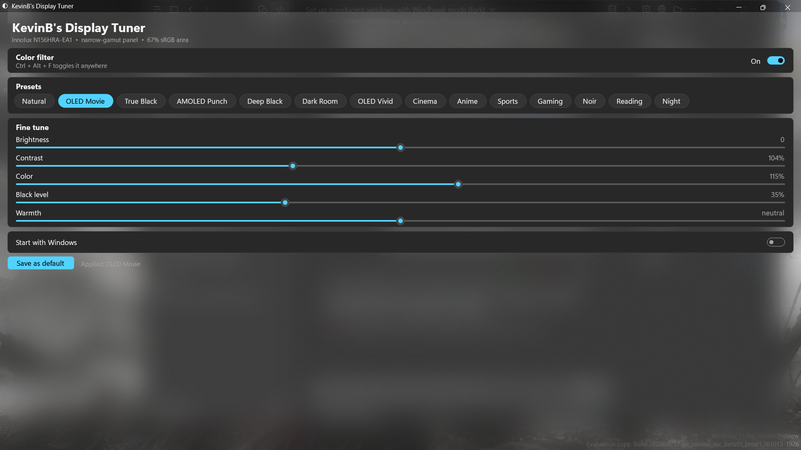
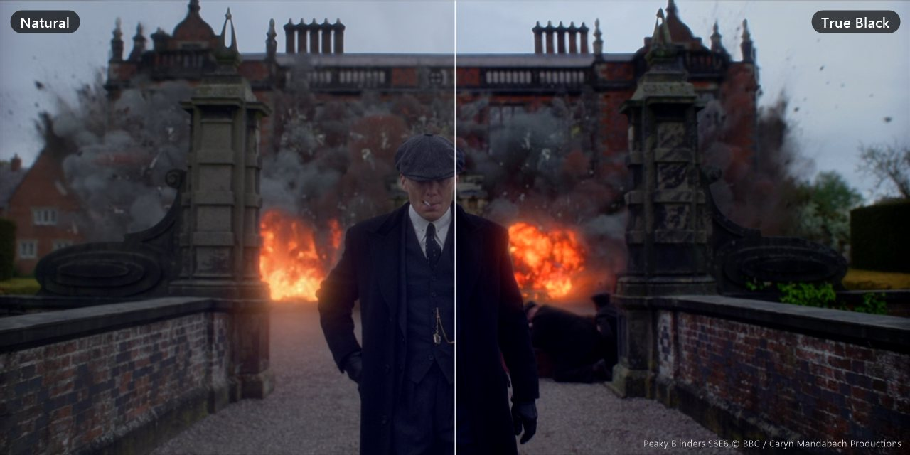
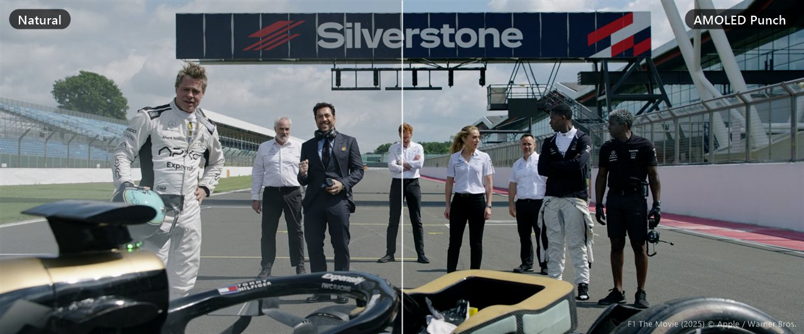

# KevinB's Display Tuner

A tiny portable Windows app that **gives an ordinary LCD/IPS laptop screen an edge**: its tuning effects bring the picture closer to the look of an **OLED or AMOLED display**, with richer color, deeper near-blacks and one-click presets. It reads your display's own data (EDID) and **tunes the presets automatically** for that panel.



- **Portable:** one `.exe`, settings saved next to it. Nothing to install.
- **Auto-tuned:** detects your panel's name and color gamut; narrow-gamut panels get more color, OLED panels skip black deepening.
- **14 presets:** Natural, OLED Movie, True Black, AMOLED Punch, Deep Black, Dark Room, OLED Vivid, Cinema, Anime, Sports, Gaming, Noir, Reading, Night.
- **Fine tune:** brightness, contrast, color, black level, warmth.
- **Ctrl + Alt + F** toggles the filter anywhere; runs quietly in the tray; optional start with Windows.

## Download

Grab `DisplayTuner.exe` from the [Releases](../../releases) page and run it. Windows 10 or 11, 64-bit.

> Windows SmartScreen may warn about an unknown publisher because the app isn't code-signed. Click **More info → Run anyway**, or build it yourself from source (below).

## See the difference

Left half untouched, right half with a preset (simulated with the app's exact color math, since screenshots can't capture the live filter). For a **drag-to-compare slider** with every preset, see the [project page](https://kevinleve.github.io/DisplayTuner/#see-the-difference).

**True Black**: deeper shadows, the fire keeps its glow.

<sub>Peaky Blinders S6E6 © BBC / Caryn Mandabach Productions</sub>

**AMOLED Punch**: richer color and contrast in daylight.

<sub>F1 The Movie (2025) © Apple / Warner Bros.</sub>

## How it works

| Part | Technique |
|---|---|
| Color, contrast, brightness, warmth | A 5×5 color matrix applied to the whole screen with the Windows **Magnification API** (`MagSetFullscreenColorEffect`) |
| Black level | A gentle curve on the display **gamma ramp** (`SetDeviceGammaRamp`) that deepens only the darkest ~20% of tones |
| Panel detection | Reads the active monitor's **EDID** (via WMI + registry): maker, model, and the red/green/blue primaries, then compares the color triangle with sRGB |

Nothing is changed permanently: exiting the app (tray icon → **Exit**) restores normal colors. See the [project page](https://KevinLeve.github.io/DisplayTuner/) for a full explanation.

## Build from source

Uses the C# compiler that ships with Windows, so no SDK is needed:

```powershell
powershell -ExecutionPolicy Bypass -File build.ps1
```

The app is written to `dist\DisplayTuner.exe`.

## Limitations

- Screenshots and recordings show normal colors; the filter only affects what the screen displays.
- Some DRM-protected video and exclusive-fullscreen games may bypass the filter.
- With several monitors, the color filter applies to all of them; presets are tuned for the main display.

## License

MIT, see [LICENSE](LICENSE).
